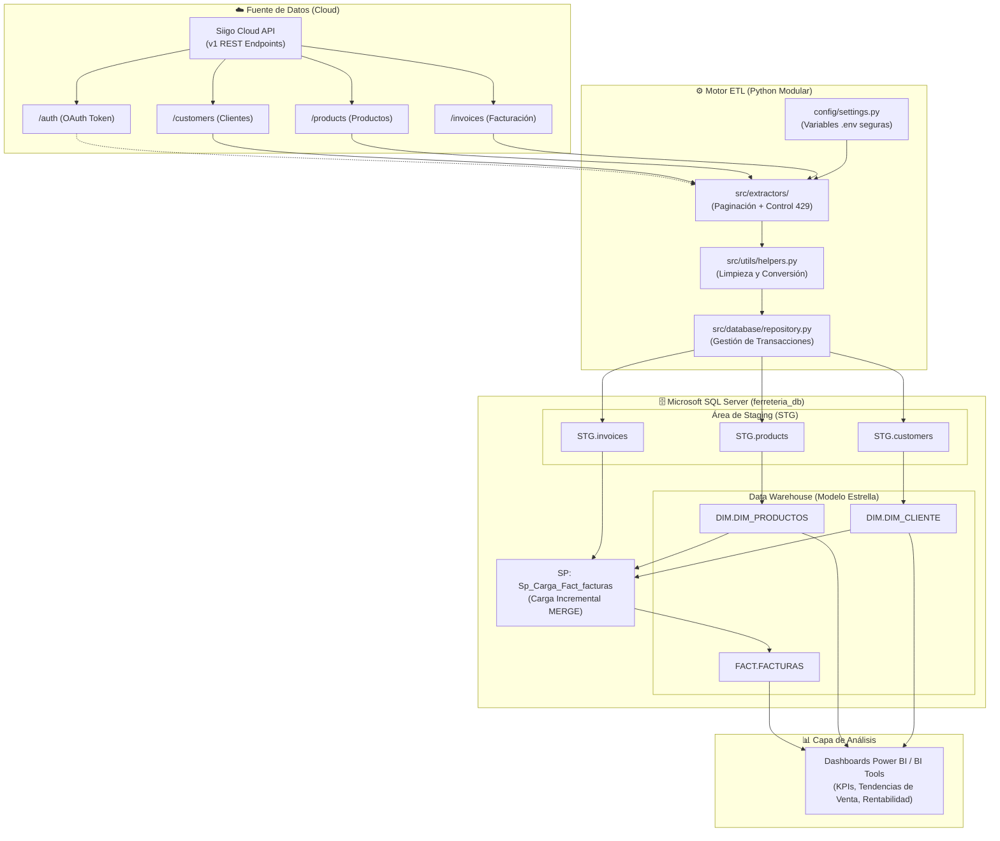

# 🏗️ Pipeline ETL & Data Warehouse - Análisis Ferretería

[](https://www.python.org/)
[](https://www.microsoft.com/sql-server)
[](https://siigoapi.docs.apiary.io/)
[](#-seguridad-y-variables-de-entorno)

Sistema automatizado de **Extracción, Transformación y Carga (ETL)** diseñado para extraer información transaccional desde la API de **Siigo Cloud** (ERP contable y comercial), almacenarla en un área de aterrizaje (**Staging**) y modelarla en un **Data Warehouse (Modelo Estrella)** sobre **Microsoft SQL Server**, habilitando análisis de ventas, clientes e inventario en herramientas de Business Intelligence (Power BI, Tableau, Excel).

---

## 📐 Arquitectura de la Solución



---

## 📁 Estructura del Proyecto

El proyecto sigue una arquitectura de software profesional desacoplada:

```text
analisis-ferreteria/
├── .env.example              # Plantilla pública de variables de entorno
├── .env                      # Credenciales locales (IGNORADO en Git por seguridad)
├── .gitignore                # Reglas estrictas de exclusión para Git
├── requirements.txt          # Dependencias y librerías del proyecto
├── README.md                 # Documentación técnica completa
├── ejecutar_main.bat         # Lanzador batch para Windows con rutas relativas
├── main.py                   # Orquestador principal del pipeline ETL
│
├── config/                   # Configuración centralizada
│   ├── __init__.py
│   └── settings.py           # Carga y validación tipada de variables de entorno
│
├── src/                      # Código fuente principal
│   ├── __init__.py
│   ├── database/             # Conexión y repositorios de base de datos
│   │   ├── __init__.py
│   │   ├── connection.py     # Manejo de sesiones y pool con pyodbc
│   │   └── repository.py     # Inserción controlada con transacciones
│   ├── extractors/           # Clientes para la API de Siigo
│   │   ├── __init__.py
│   │   ├── auth.py           # Gestión de Bearer Token de Siigo
│   │   ├── customers.py      # Extracción paginada de clientes
│   │   ├── products.py       # Extracción de productos y catálogo
│   │   └── invoices.py       # Extracción y aplanado de facturas
│   └── utils/                # Utilidades comunes y soporte
│       ├── __init__.py
│       ├── helpers.py        # Conversiones seguras (safe_float, safe_date, safe_bit)
│       └── logger.py         # Logging profesional a consola y archivo
│
├── sql/                      # Scripts DDL y Procedimientos de Base de Datos
│   ├── 01_init_database_and_schemas.sql   # Inicialización de DB y esquemas STG, DIM, FACT
│   ├── 02_staging_tables.sql              # Creación de tablas de aterrizaje
│   ├── 03_dim_fact_schema.sql             # Tablas dimensionales y de hechos
│   └── 04_stored_procedures.sql           # Procedimiento MERGE de facturación
│
└── logs/                     # Archivos de registro de ejecución (ignorados en Git)
    └── .gitkeep
```

---

## 🔐 Seguridad y Variables de Entorno

> [!IMPORTANT]
> **Nunca expongas tus credenciales**: Ninguna clave secreta, usuario, correo ni contraseña de base de datos debe estar escrita en el código ni subida a GitHub.

El proyecto implementa protección mediante el patrón estándar `.env`:
1. El archivo `.env` almacena tus secretos localmente y está listado en `.gitignore`.
2. Se incluye el archivo `.env.example` que sirve como modelo para desplegar el proyecto en cualquier entorno nuevo.

### Configurar tus credenciales:
1. En la raíz del proyecto, copia la plantilla:
   ```cmd
   copy .env.example .env
   ```
2. Abre el archivo `.env` y coloca tus datos reales:
   ```ini
   # Credenciales de Siigo API
   SIIGO_USERNAME=tu_correo_registrado_en_siigo@ejemplo.com
   SIIGO_ACCESS_KEY=tu_access_key_generado_en_siigo
   SIIGO_PARTNER_ID=AnalisisFerreteria
   SIIGO_AUTH_URL=https://api.siigo.com/auth
   SIIGO_API_BASE_URL=https://api.siigo.com/v1

   # Conexión a SQL Server
   DB_DRIVER=ODBC Driver 17 for SQL Server
   DB_SERVER=localhost\SQLEXPRESS
   DB_NAME=ferreteria_db
   DB_TRUSTED_CONNECTION=yes
   DB_ENCRYPT=no
   DB_TRUST_SERVER_CERTIFICATE=yes
   ```

---

## 🚀 Guía de Instalación y Puesta en Marcha

### 1. Prerrequisitos
- **Python 3.10 o superior**: [Descargar Python](https://www.python.org/downloads/)
- **Microsoft SQL Server** (2017, 2019 o 2022): Express, Developer o Standard.
- **ODBC Driver 17 for SQL Server**: [Descargar Driver de Microsoft](https://learn.microsoft.com/sql/connect/odbc/download-odbc-driver-for-sql-server)

### 2. Clonar el repositorio
```bash
git clone https://github.com/SamuelM06/analisis-ferreteria.git
cd analisis-ferreteria
```

### 3. Crear y activar el entorno virtual
```cmd
# Crear el entorno virtual
python -m venv env

# Activar en Windows (PowerShell)
.\env\Scripts\Activate.ps1

# Activar en Windows (CMD)
.\env\Scripts\activate.bat
```

### 4. Instalar dependencias
```bash
pip install -r requirements.txt
```

### 5. Configurar la Base de Datos en SQL Server
Abre SQL Server Management Studio (SSMS) o Azure Data Studio y ejecuta en orden los scripts ubicados en la carpeta `sql/`:
1. `sql/01_init_database_and_schemas.sql` (Crea la base de datos `ferreteria_db` y los esquemas `STG`, `DIM`, `FACT`).
2. `sql/02_staging_tables.sql` (Crea tablas `STG.products`, `STG.customers`, `STG.invoices`).
3. `sql/03_dim_fact_schema.sql` (Crea dimensiones y tabla de hechos).
4. `sql/04_stored_procedures.sql` (Crea el procedimiento de carga incremental `Sp_Carga_Fact_facturas`).

---

## 💻 Ejecución del Pipeline

### Opción A: Ejecución Directa en Python
Con el entorno virtual activado y el archivo `.env` configurado:
```bash
python main.py
```

### Opción B: Ejecución con el Lanzador Batch (Recomendado para Automatización)
Simplemente haz doble clic o ejecuta en la consola:
```cmd
ejecutar_main.bat
```
Este script:
- Resuelve rutas automáticamente de forma relativa (`%~dp0`), funcionando sin importar la carpeta donde se encuentre.
- Detecta el entorno virtual `env/` automáticamente.
- Registra el resultado y código de salida en `logs/log_tarea.txt`.

---

## ⏰ Automatización con el Programador de Tareas de Windows

Para ejecutar el pipeline diariamente o periódicamente:
1. Abre el **Programador de tareas** de Windows (`taskschd.msc`).
2. Haz clic en **Crear tarea básica...**.
3. Nombre: `ETL_Analisis_Ferreteria`.
4. Desencadenador: **Diariamente** (ejemplo: `02:00 AM`).
5. Acción: **Iniciar un programa**.
6. En **Programa o script**, selecciona la ruta de `ejecutar_main.bat`.
7. En **Iniciar en (opcional)**, escribe la ruta completa del proyecto (ej. `C:\Developer\Data`).
8. Guarda la tarea.

---

## 🔄 Características Técnicas del Pipeline

- **Control de Rate Limiting (HTTP 429)**: Manejo automático de reintentos con backoff para cumplir las políticas de la API de Siigo sin interrupciones.
- **Detección de Nuevos Registros**: Comprobación de existencia de IDs en la base de datos antes de insertar, optimizando tiempos y evitando duplicados.
- **Carga de Facturas Aplanadas**: Conversión de estructuras anidadas (factura -> ítems -> impuestos) en filas normalizadas para análisis relacional.
- **Gestión Transaccional Segura**: Operaciones bajo `commit` y `rollback` automáticos ante cualquier error de red o base de datos.
- **Logging Rotativo**: Registro detallado en consola y en `logs/etl_ferreteria.log` para trazabilidad y auditoría.

---

## 🤝 Contribución y Buenas Prácticas

1. Crea una rama para tu feature (`git checkout -b feature/nueva-mejora`).
2. Realiza tus cambios asegurándote de no incluir archivos de credenciales (`.env`).
3. Verifica la ejecución con `python main.py`.
4. Haz commit y push de tus cambios (`git commit -m "feat: nueva funcionalidad"`).
5. Abre un Pull Request describiendo los cambios realizados.
